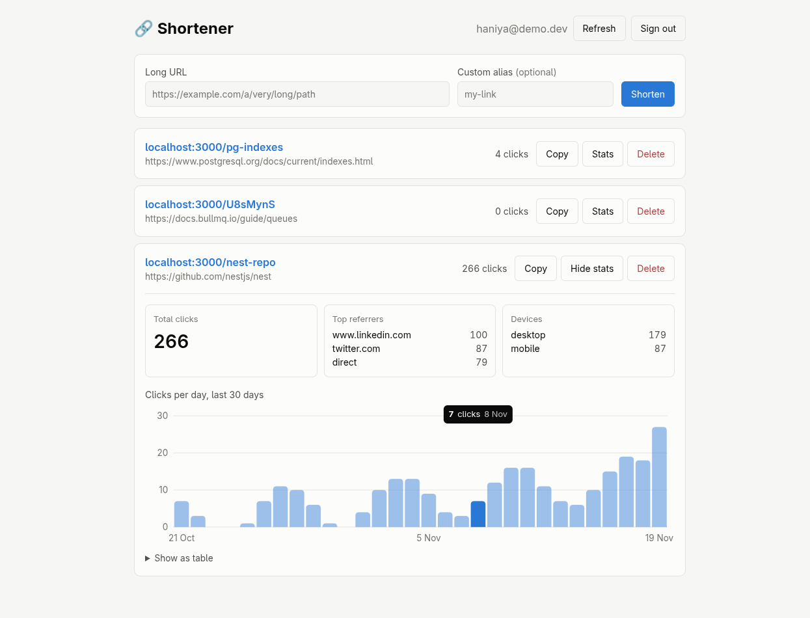
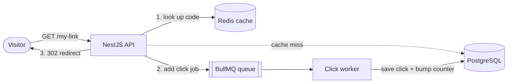

# URL Shortener

[](https://github.com/haniyaiqbal/url-shortener/actions/workflows/ci.yml)

A URL shortener with click analytics, built with **NestJS, PostgreSQL, Redis and BullMQ**.

Paste a long link, get a short one like `sho.rt/my-link`, and see who's clicking it: clicks per day, where they came from, and what device they used.



## Features

- **Short links** with random codes (`/5qAVIIk`) or your own alias (`/my-link`)
- **Optional expiry date**: expired links return `410 Gone`
- **Fast redirects** served from a Redis cache, so most clicks never touch the database
- **Click tracking in the background** with a BullMQ queue, so counting a click never slows down the redirect
- **Stats per link**: total clicks, clicks per day (last 30 days), top referrers, devices
- **Accounts** with JWT login; each user only ever sees their own links
- **Rate limiting** on sign-up, sign-in and link creation
- **Swagger docs** at `/docs`, and health checks at `/health/live` and `/health/ready`
- A small **React dashboard** for creating links and viewing stats

## How it works



When someone opens a short link:

1. The API looks up the code in **Redis**. If it's not there, it reads it from **Postgres** and caches it for next time.
2. It puts a small "record this click" job on a **BullMQ** queue. This takes about a millisecond.
3. It sends the visitor on their way with a `302` redirect.

A **background worker** then picks up the job and saves the click in a database transaction, so the click row and the link's counter always agree.

## Design decisions

These are the choices worth talking about, and why I made them.

| Decision | Why |
|---|---|
| **302 instead of 301 redirects** | Browsers cache 301s forever, so repeat clicks would never reach the server and wouldn't be counted. |
| **Clicks go through a queue** | Writing to Postgres on every redirect would make redirects slower and tie their speed to the database. With the queue, a slow database only delays the stats, never the visitor. Failed jobs retry with exponential backoff. |
| **Cache is cleared on edit and delete** | Without this, an edited link would keep pointing to the old URL until the cache expired. Cached entries also never outlive the link's own expiry date. |
| **Random codes use `crypto.randomInt`** | 7 base62 characters give about 3.5 trillion combinations. In the rare case of a collision, the unique index catches it and the app simply tries a new code. |
| **Someone else's link returns 404, not 403** | A 403 would confirm that the link exists. A 404 reveals nothing. |
| **Only the referrer's hostname is stored** | Full referrer URLs can contain private data (tokens, search terms). The hostname is enough for stats. |
| **Migrations instead of `synchronize`** | Schema changes are reviewed SQL files that run on startup. CI also checks that the migrations exactly match the entities. |
| **Password checks take the same time for unknown emails** | So nobody can find out which emails are registered by timing the login response. |

## Tech stack

| Part | Tools |
|---|---|
| API | NestJS 12, TypeScript (ESM), Zod validation |
| Database | PostgreSQL 17, TypeORM with migrations |
| Cache and queue | Redis 7, `@nestjs/cache-manager`, BullMQ |
| Auth | `@nestjs/authentication` (JWT, scrypt password hashing) |
| Docs and health | Swagger (OpenAPI), `@nestjs/terminus` |
| Frontend | React 19, Vite |
| Testing | Vitest (unit and end-to-end), Supertest |
| DevOps | Docker, Docker Compose, GitHub Actions |

## Run it

You need **Docker**. That's all.

```bash
docker compose up --build
```

Then open:

- **Dashboard:** http://localhost:8080
- **API docs (Swagger):** http://localhost:3000/docs
- **Short links** work at http://localhost:3000/your-code

### Run it for development

```bash
docker compose up -d postgres redis   # just the database and Redis
cp .env.example .env
npm install
npm run start:dev                     # API on http://localhost:3000

cd web && npm install && npm run dev  # dashboard on http://localhost:5173
```

## API

| Method | Path | What it does |
|---|---|---|
| `POST` | `/api/auth/sign-up` | Create an account, returns a token |
| `POST` | `/api/auth/sign-in` | Sign in, returns a token |
| `GET` | `/api/auth/me` | The signed-in user |
| `POST` | `/api/links` | Shorten a URL (`url`, optional `alias` and `expiresAt`) |
| `GET` | `/api/links` | Your links (`?page=1&limit=20`) |
| `GET` | `/api/links/:id` | One link |
| `GET` | `/api/links/:id/stats` | Click stats for a link |
| `PATCH` | `/api/links/:id` | Change the target URL or expiry |
| `DELETE` | `/api/links/:id` | Delete a link |
| `GET` | `/:code` | Redirect to the original URL |

Example:

```bash
# Sign up and keep the token
TOKEN=$(curl -s -X POST localhost:3000/api/auth/sign-up \
  -H 'Content-Type: application/json' \
  -d '{"email":"me@example.com","password":"a-long-password"}' | jq -r .accessToken)

# Shorten a link
curl -X POST localhost:3000/api/links \
  -H "Authorization: Bearer $TOKEN" -H 'Content-Type: application/json' \
  -d '{"url":"https://github.com/nestjs/nest","alias":"nest"}'

# Open it
curl -i localhost:3000/nest   # → 302, Location: https://github.com/nestjs/nest
```

## Tests

```bash
npm test            # unit tests
npm run test:e2e    # end-to-end tests (needs: docker compose up -d postgres redis)
```

The end-to-end tests run the real app against real Postgres and Redis. They cover signing up, shortening a link, following it, waiting for the worker to record the click, checking the stats, cache clearing after an edit, and making sure users can't see each other's links.

## Database migrations

```bash
npm run migration:generate -- src/database/migrations/<Name>   # after changing an entity
npm run migration:run
npm run migration:check   # fails if entities and migrations don't match
```

## Project structure

```
src/
  auth/       sign-up, sign-in, JWT provider
  users/      user entity and lookups
  links/      link CRUD, redirect, Redis cache, short codes
  clicks/     BullMQ queue, click worker, stats queries
  health/     liveness and readiness checks
  database/   data source and migrations
  config/     environment variable validation
test/         end-to-end tests
web/          React dashboard
```

## License

MIT
